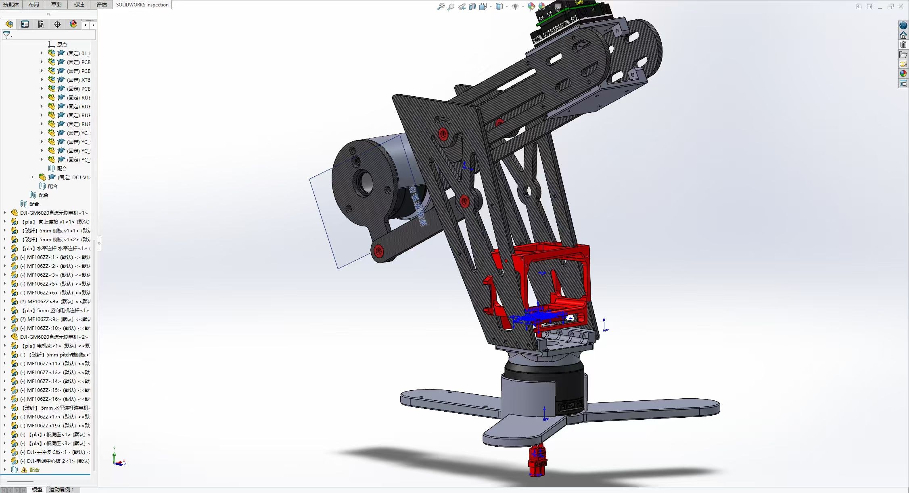

# lyf 的第二次求助

## 一、这次轮到控制组了

[前情提要：lyf 的求助](https://herkules.notion.site/Reading-Week-lyf-28ac04c2f00e80088b9fcede240d1986?source=copy_link)

经历了一番修改，lyf 终于把 yaw、pitch 云台教具交到了控制组手里。电机、控制板都准备好了，他长舒一口气：“这次总该能转了吧。”

但把车上的控制程序搬过来，事情并没有结束。平时用来操纵机器人的模式，不一定适合站在教具旁边调参数：我们想单独调速度环，想随时停下输出，想在参数调得不合适时记录问题，改好以后再继续。

lyf 看着一会儿慢吞吞、一会儿反复点头的云台，问道：“所以，这次应该不是结构的问题了吧？”

这一次，你要为控制组开发一个**教具专用的云台调试模式**。让这台教具方便启动、回正、分环调参、发现异常和人工恢复。



## 二、准备工作

模板地址：[control-training-template](https://github.com/HKUAstar/control-training-template)

### 1. 环境怎么准备？

先完成 [Lecture 0 环境配置](https://training.herkules.dev/learn/lecture-0)。之前装好的 Git、Rust 和系统编译工具可以继续使用，这次不需要 ROS 2。建议使用 VS Code，并安装 `rust-lang.rust-analyzer` 扩展。

打开终端，先检查：

```sh
git --version
rustup --version
cargo --version
```

然后额外安装 **probe-rs**，用于通过调试探针烧录固件和读取日志：

```sh
cargo install probe-rs-tools --locked
probe-rs --version
```

安装包叫 `probe-rs-tools`，运行的命令叫 `probe-rs`。安装完成后如果找不到命令，先重新打开终端。Windows 沿用前课配置的编译工具；连接探针若遇到驱动或权限问题，按 [probe-rs 官方说明](https://probe.rs/docs/getting-started/installation/) 和助教提供的探针型号处理。

#### 用模板创建自己的仓库

1. 打开 [作业模板](https://github.com/HKUAstar/control-training-template)。
2. 点击 **Use this template → Create a new repository**，在自己的账号下创建作业仓库。
3. 进入新仓库，点击 **Code**，复制自己的仓库地址。
4. clone 自己的仓库，再用 VS Code 打开。例如，若新仓库叫 `gimbal-training`：

```sh
git clone https://github.com/YOUR_USERNAME/gimbal-training.git
cd gimbal-training
code .
```

将 `YOUR_USERNAME` 和仓库名换成自己的。不要直接 clone 教师模板后向原仓库提交。开发时定期 commit、push，完成后提交自己的仓库链接。

如果没有 `code` 命令，也可以在 VS Code 中选择“文件 → 打开文件夹”。在工程内运行 Cargo 时，rustup 会按 `rust-toolchain.toml` 获取固定工具链及 Cortex-M7 目标，首次需要联网。若固定版本无法下载，保留报错交给助教核对，不要自行删除版本配置。

连接助教提供的 SWD 调试探针后，可检查电脑是否识别到：

```sh
probe-rs list
```

### 2. 程序从哪里开始？

工程主要有两个源码文件：

| 文件 | 内容 | 本次怎样使用 |
|---|---|---|
| `src/dm_mc02.rs` | 开发板初始化、CAN1、DR16 接收、看门狗和异常处理 | 阅读即可 |
| `src/main.rs` | 电机、PID、状态机和控制任务 | 本次主要修改位置 |

模板使用 Rust，目标开发板是 DM-MC02（STM32H723VG）。环境配置好后，在工程根目录执行：

```sh
cargo build --release --locked
cargo run --release --locked
```

第一条编译；第二条通过调试器烧录并显示 RTT 日志。模板启动日志为 `Gimbal control started`，可以改成自己的标识。电脑上结束日志会话不等于给电机发送停止指令。

### 3. 一个控制周期做什么？

模板每 1 ms 执行一次控制，也就是 1 kHz。顺序已经搭好：

```rust
self.read_remote();      // 遥控器输入是否有效？
self.read_feedback(can); // 收到的电机反馈是什么？
self.update_mode();      // 现在应该处于哪个状态？
self.update();           // 这个状态下应给多少输出？
self.transmit(can);      // 把计算结果真正发给电机
```

### 4. 电机变量分别是什么？

模板里的 `Motor` 保存一个电机的反馈和电流指令：

```rust
pub struct Motor {
    pub angle_rad: f32,
    pub speed_rpm: f32,
    pub current_raw: i16,
    pub command_current_a: f32,
}
```

| 字段 | 含义 | 单位／注意事项 |
|---|---|---|
| `angle_rad` | 当前电机轴角度 | rad；模板尚未实现多圈累计 |
| `speed_rpm` | 当前电机轴转速 | rpm |
| `current_raw` | 反馈电流 | 协议原始值；手册未给出换算到 A 的比例 |
| `command_current_a` | 控制器计算的电流指令 | A；发送前还要换算成协议数值 |

例如，在已经取得有效电机对象后，可以这样访问字段：

```rust
let angle = motor.angle_rad;
let speed = motor.speed_rpm;
motor.command_current_a = 0.0;
```

两轴放在 `Control` 的 `yaw`、`pitch` 中，类型为 `Axis`，各自包含电机、目标和 PID：

```rust
pub struct Axis {
    pub motor: Motor,
    pub target_angle_rad: f32,
    pub target_rpm: f32,
    pub position_pid: Pid,
    pub speed_pid: Pid,
}
```

| 字段 | 含义 | 单位／注意事项 |
|---|---|---|
| `motor` | 该轴的电机 | 电机 ID 由教具配置给出 |
| `target_angle_rad` | 希望达到的角度 | rad；是位置环目标 |
| `target_rpm` | 希望达到的电机轴转速 | rpm；是速度环目标，由位置环输出给出 |
| `position_pid` | 位置环 | 输入 rad，输出 rpm |
| `speed_pid` | 速度环 | 输入 rpm，输出 A |

### 5. 电机指令怎样发出去？

协议部分有两处需要你补全：

- `Motor::read(&mut self, data: &[u8; 8])`：把一帧八字节反馈转换成角度、速度和电流。反馈帧应该怎样对应到 yaw 或 pitch，请查手册并补全 `Control::read_feedback`。
- `Control::transmit` 中的 `data`：把两轴的 `command_current_a` 限幅、换算后写入各自电机 ID 对应的字节，其他字节保持为零。

模板用 `MOTOR_COMMAND_ID = 0x1FE` 发送电流模式组指令。`Control::transmit` 每个周期都会发送一帧，模板中 `data` 全为零，所以未补全前电机只会收到零电流。发送队列满时（例如总线上没有电机应答）这一帧会被丢弃，并计入全局计数 `TX_FAILED`，不会 panic。接收到的 CAN 总线错误交给 `dm_mc02::log_can_error`，计入 `CAN_ERRORS`。

已有停止接口：

```rust
motor.disable();   // 清除这个电机的电流指令
self.disable_all(); // 清除两轴电机的指令
```

这两者只修改内存，**不会自己发送 CAN 帧**，要等 `Control::transmit` 在本周期末尾发送，所以停止依赖发送正常工作。你需要保证零电流被编码为协议零值。零电流也不等于主动刹车或保持原角度。

### 6. 遥控器怎么用？

**本次用左边同一根摇杆控制云台：左右控制 yaw，上下控制 pitch。** 右摇杆不控制这两轴。

```rust
// 放在 Control 的方法中；先读取输入，不在这里直接写电流。
if let Some(remote) = self.remote {
    let yaw_input = remote.channels[2] as f32 / 660.0;
    let pitch_input = remote.channels[3] as f32 / 660.0;
    let left_switch = remote.left_switch;
    let right_switch = remote.right_switch;
    // 接下来由你实现死区、方向、目标更新和状态判断。
}
```

本次规定摇杆控制**目标角度的变化速度**：拨住时目标持续向相应方向移动，拨得越多变化越快；松手后目标停止变化，角度双环继续保持该目标。

归一化输入经过死区与方向处理后，乘以设定的最大目标角速度，再乘本周期时间，累加到目标角度。目标角速度若用 rad/s，则时间用 s，累加结果为 rad；这与速度环使用的电机 rpm 要区分。根据实际安装校准方向，验收为摇杆左／右对应云台左／右，上／下对应抬头／低头。pitch 目标需限幅，yaw 按教具允许范围和角度回绕约定处理。

右上角拨杆对应 `remote.right_switch`。本次统一规定：

| 操作 | 效果 |
|---|---|
| 右上拨杆拨到中位（`3`） | enable：条件满足后启动回正，再进入遥控调试 |
| 右上拨杆拨到下位（`2`） | disable：取消两轴输出，返回等待 |
| 左摇杆左右／上下 | 分别移动 yaw／pitch 的目标角度 |
| 故障后的退出操作 | 自己设计，现场说明，不允许自动恢复 |

上位（`1`）不作为使能。默认按停用处理；如果把它用作故障退出操作，也必须明确处理过程，不能上拨后立即带输出。

使用右上拨杆的代码入口如下，具体切换逻辑由你补全：

```rust
if let Some(remote) = self.remote {
    let enable_position = remote.right_switch == 3;
    let disable_position = remote.right_switch == 2;
    // 还需要结合当前状态、反馈和上次拨杆位置判断。
}
```

不要只看到中位就反复启动。首次上电或遥控器重新连接后，应先下拨，再拨到中位，识别一次新的使能操作。故障退出还需要你设计的独立人工确认，不能只因拨杆一直在中位就恢复。

接收不到有效输入达 100 个控制周期（约 100 ms），或接收任务报告无效帧／串口错误时，模板会清零指令并回到 `Waiting`。恢复信号后不能自动使能，启动必须识别为一次新的操作。当前模板还可能让断联覆盖 `Error`，因此故障原因／故障锁存不要只靠 `State::Error` 保存；未处理的故障不能因遥控器断开再接通而消失。

### 7. 需要自己查的两份手册

**遥控器手册**：阅读“遥控器操作”“Robomaster 战车控制协议”“18 字节控制帧结构”及解析示例

- 通道原始中值和范围是什么？
- 开关上、中、下分别是什么值？与 `Dr16::parse` 如何对应？

**电机手册**：阅读“拨码开关设置”“使用”“CAN 通信协议”：

- 根据教具电机 ID，找出反馈 ID、组指令 ID 和所在字节槽位。
- 查清角度、转速、反馈电流和指令的字段、符号与单位；对文档没有明确的换算单独注明，不能直接套其他字段的比例。
- 实现反馈解码、指令限幅和编码；验证零值、正负值、边界值及未使用槽位。
- 解释机械角度越过一圈边界时会发生什么，以及程序怎样避免误差突变。

### 8. PID 在代码里是什么样？

模板现在只有接口，没有成员和计算内容：

```rust
pub struct Pid {}

impl Pid {
    pub fn reset(&mut self) { todo!("清理 PID 历史"); }
    pub fn calculate(
        &mut self,
        _target: f32,
        _measured: f32,
        _dt_s: f32,
    ) -> f32 { todo!("实现 PID 运算"); }
}
```

上面是接口节选，不是完整实现。速度环输入为 rpm，输出为 A，每次调用的 `dt_s` 为 `0.001`。你需要添加增益、积分、历史数据和限制，并完成 `reset`、`calculate`。

双环的连接为：`Axis::target_angle_rad` 交给 `position_pid`，它的输出写入 `target_rpm`，再交给 `speed_pid`，最后得到该轴电机的 `command_current_a`。`yaw`、`pitch` 各有一组 PID，历史状态互不影响。若位置环输出 rad/s，先换算成 rpm 再接速度环。

### 9. 状态机是什么？

状态机就是让程序记住“现在处于哪个阶段”，再据此决定允许什么操作、给什么输出。

模板已经给出四个状态名称：

```rust
pub enum State {
    Waiting,
    Prepare,
    Running,
    Error,
}
```

| 状态 | 在等什么／做什么 |
|---|---|
| `Waiting` | 零输出。等待遥控输入有效、两轴反馈新鲜，再等一次新的使能操作 |
| `Prepare` | 回正：限速限流地把两轴转到参考姿态，等两轴稳定后进入 `Running` |
| `Running` | 遥控调试：左摇杆移动目标角度，两轴双环跟随 |
| `Error` | 零输出，等待人工恢复 |

初始状态为 `Waiting`。`update_mode` 中已经搭好 `match self.state` 的四个分支，分支内容还需要填写。

## 三、你需要把它做成什么样？

### 1. 等待：没启动就不主动运动

`Waiting` 下输出为零。只有两轴反馈新鲜有效，并收到一次明确启动操作，才能进入 `Prepare`。

### 2. 回正：先回到约定的参考姿态

GM6020 提供单圈绝对角度反馈，原始机械角度范围为 `0～8191`，一圈共 `8192` 个刻度。它能告诉你电机轴在一圈内的位置，但不知道教具的“正前方／水平”对应哪个刻度，也不记录断电前转过多少整圈。

**先标定教具零位，再编写回正：**

1. 在取消输出并支撑好教具的条件下，将 yaw 摆到约定正前方、pitch 摆到约定水平姿态。
2. 读取两轴稳定的机械角度，分别记录为 yaw、pitch 零位常量；保存到教具配置中，不填写虚构数值。
3. 轻微改变姿态，确认反馈正方向；将当前读数与零位之差换算成关节角度。直接驱动时，电机计数差乘 `2π / 8192` 得到 rad，再结合安装方向；存在传动时必须加入传动关系。
4. 重新上电，在禁止输出时验证同一物理姿态的读数可重复，再低输出验证回正。拆装或改变传动关系后重新核对零位。

计数会跨越 `8191` 和 `0`，不能直接相减后当成很大的角度误差。直驱、允许最短路径的轴可以把差值折回半圈范围；pitch 必须选择限位内可达的路径，不能盲目套最短路径。yaw 如果有线缆或多圈限制，也需要额外的圈数／路径约束。仅靠电机单圈反馈无法区分传动后重复出现的多个关节位置。

这次设置的是程序中的机械零位偏移，不是每次启动把当前姿态当零位，也不是修改电机内部编码器。只有教具传动和允许范围内的位置可唯一确定时，才启用自动回正；若现场不能满足，先停用回正，由助教确定额外定位方式。

本次把 `Prepare` 扩展为准备和回正阶段。回正是把两轴平稳转到教具约定的参考方向，不是撞限位，也不是随意把当前读数设成零。

进入时初始化控制器与目标；过程中限制速度和输出；判断两轴的角度误差、速度连续一段时间满足要求后，再进入 `Running`。参考姿态、允许范围和限制采用教具配置，不自己猜。

回正超时或出现异常，应退出并停止输出。

遥控输入无效时，模板会清零指令并回到 `Waiting`。其余情况下发送阶段不再检查状态：`Waiting` 和 `Error` 下的零输出需要你在 `Control::update` 中调用 `disable_all` 实现。电机反馈有效性、回正限速限流及状态切换也由你实现。

### 3. 调试：遥控器控制云台

`Running` 下，左摇杆左右控制 yaw、上下控制 pitch，双环 PID 让两轴跟随目标。松手后保持目标角度，右上拨杆下拨则取消输出。

调速度环时，把位置环输出限幅 `maxout` 设为 `0`，使位置环输出的目标速度始终为零，再调整速度环参数。PID 的最终输出必须对称限制在 `[-maxout, maxout]`，这样 `maxout = 0` 才确实得到零输出。`maxout` 是本次需要添加的参数，模板尚未定义该字段。

重新调位置环时恢复合理的位置环 `maxout`，再从小增加位置环 Kp。修改前先 disable，重新初始化目标和 PID 历史；不要求在线修改参数。

### 4. 故障：先停止，再让人处理

自行实现至少两类判断：

- 疑似卡住：输出较大、误差持续存在，但速度很低。
- 持续剧烈振荡：误差反复变化，且幅度或速度持续较大。

上述是思路，不是直接可用的判据。你需要组合阈值、持续时间或窗口，避免把正常静止保持、一次超调和微小噪声误判为故障，并记录触发原因。

触发后进入 `Error`，两轴发送零输出。用户处理问题或修改参数后，收到一次新的恢复操作，且反馈等基本条件正常，才可重新进入 `Running`。恢复时以当前角度初始化角度目标，速度目标归零，清理 PID 历史；持续不正常时不允许强行恢复。

反馈超时按模板要求回到 `Waiting`，重新获得反馈后仍需启动并回正。若修改参数导致重新烧录或重启，也重新走启动流程。软件故障恢复与看门狗复位后的板级锁定是两回事；后者按模板提示需要手动 RESET。

### 5. 哪些地方由你补全？

| 位置 | 需要完成什么 |
|---|---|
| `Pid` | 添加参数、积分、历史数据及限制 |
| `Pid::reset` | 清理历史状态，定义首次计算的初始化方式 |
| `Pid::calculate` | 使用时间间隔计算 PID，处理积分与输出限制 |
| `Control`、`Default` | 设置两轴的 PID 参数，添加反馈年龄、故障记录等 |
| `Control::update_mode` | 完整的判断、切换和进入／退出处理 |
| `Control::update` | 回正、遥控双环控制及禁止输出状态下的具体行为 |
| `Motor::read`、`Control::transmit` | 根据电机手册完成解码、换算、限幅与编码 |
| `Control::read_feedback` | 筛选反馈帧、检查长度、路由到电机，并更新反馈年龄 |
| 自行新增的检测函数 | 卡住、持续振荡、回正完成及回正超时等判断 |

`Motor::read`、`Control::transmit` 中的编码和 `Control::read_feedback` 中的路由都需要自己完成。先根据手册把反馈接收、解码和指令编码跑通，确认角度、速度及单位正确，再开始 PID 调试。

底层 CAN 初始化、缓冲队列和非阻塞收发入口已经提供，不需要重写。但接收循环取到的帧还没有自动变成电机反馈：你仍需筛选 ID、检查长度、找到对应电机并调用 `Motor::read`，同时记录反馈年龄。缺少这一步，PID 没有有效反馈，不能进行闭环调试。

## 四、PID 调试

1. **先看反馈。** 先不使能电机，确认两轴对应正确，手动改变姿态时角度和速度方向符合说明。准备好停止操作。
2. **确认闭环方向。** 在低输出限制下检查输出方向，确认负反馈后再逐渐调参。
3. **单独调速度环。** 将位置环 `maxout` 设为 `0`，确认目标速度为零；速度环积分和微分先设为零，从小增加速度环 Kp。在允许施加轻微扰动的位置操作，感受抵抗转动的变化，记录速度和电流曲线。Kp 过大可能抖动。零速度环抵抗运动，但不保证回到原角度。
4. **再调位置环。** 保持稳定的速度环参数，恢复合理的位置环 `maxout`，从小增加位置环 Kp，给出小幅目标变化，观察跟踪快慢、超调，以及目标／实际速度。根据结果决定是否需要其他项，一次只改少量参数。
5. **检查模式切换。** 验证启动回正、遥控、停止、故障和恢复，观察切换瞬间有没有突然运动。

## 五、怎样实时看参数和曲线？

使用 VS Code 插件 **[Tuning Studio](https://marketplace.visualstudio.com/items?itemName=hxyulin.tuning-studio)**，扩展 ID 为 `hxyulin.tuning-studio`。它与 probe-rs 不是同一个工具：probe-rs 负责烧录等操作，Tuning Studio 提供变量查看、曲线与记录界面。插件平台包已包含自己的后台程序，不必自行编译插件源码。

### 1. 安装插件

在 VS Code 扩展中搜索 Tuning Studio，确认发布者为 `hxyulin`；也可以运行：

```sh
code --install-extension hxyulin.tuning-studio
```

### 2. 编译并烧录

```sh
cargo build --release --locked
cargo run --release --locked
```

确认固件运行后，在终端按 Ctrl+C 退出 probe-rs 日志会话，释放调试探针。此操作不等于 disable，操作电机仍使用右上拨杆。VS Code 调试器和 Tuning Studio 也不能同时占用同一个探针。

### 3. 连接并画曲线

本节按 Tuning Studio 0.1.3 编写，更早的版本界面不同。

1. 命令面板执行 `Tuning Studio: Open Scope`，打开 Tuning Scope 面板。
2. 点击面板左上角 **Open firmware…**，选择本次烧录对应的 `target/thumbv7em-none-eabihf/release/control-training-template`。这是不带扩展名的固件文件，不是 `.rs` 源码。不要选择旧编译结果。
3. 点击右上角 **Connect…**，选择 SWD 调试探针和芯片 `STM32H723VGTx`。
4. 左侧 Live Watch 中展开 **Tasks → control_task → control**，里面是 `Control` 的全部字段，例如 `yaw`、`pitch`、`state`。顶部输入框可按名称筛选。
5. 点击数值右侧的方块，把该字段加入右侧曲线；再点一次取消。
6. 工具栏可选择 2、5、10、30 s 时间窗口，**Pause** 暂停画面，**Record** 开始记录到工程的 `.tuning-studio/recordings/`，再点一次停止。

默认采样率为 100 Hz，可用 `Tuning Studio: Change Sample Rate…` 修改。控制循环仍为 1 kHz，曲线采样率不是控制频率；较慢采样不能证明没有高频抖动。

## 六、提交内容

在平台上提交自己的 **GitHub 作业仓库链接**即可，不需要额外上传报告、ZIP 或演示视频。

完成代码后，带电脑和准备好的代码来实验室，使用云台教具进行现场调试与验收。来之前先确认工程能够编译，代码已 commit 并 push 到自己的仓库。
